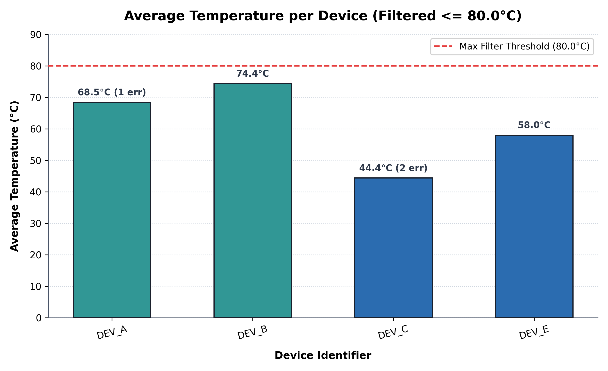

# Device Log Summarizer

[](https://www.python.org/)
[](./tests/)

CLI tool and data processing pipeline for the **Software Engineering Intern Technical Assessment**.

---

## Project Structure

```text
.
├── section1_sanitization.py    # Section 1: Data cleaning & clipping function
├── device_log_summarizer.py    # Section 2: Telemetry aggregation & filtering CLI tool
├── visualize_temperatures.py   # Section 3: Matplotlib visualization script
├── device_telemetry.csv        # Sample input telemetry dataset
├── summary_output.json         # Exported JSON summary
├── device_temperatures.png     # Generated bar chart
├── PROMPT_LOG.md               # Deliverable: AI prompt engineering log
├── requirements.txt            # Project dependencies
├── README.md                   # Documentation
└── tests/
    ├── __init__.py
    ├── test_sanitization.py    # Tests for Section 1
    ├── test_summarizer.py      # Tests for Section 2
    └── test_visualizer.py      # Tests for Section 3
```

---

## Setup & Requirements

- Python 3.9+
- Install dependencies:
```bash
pip install -r requirements.txt
```

---

## Section 1: Data Cleaning & Normalization

**File:** `section1_sanitization.py`

Implements `clean_and_normalize_sensor_readings(readings)` in pure Python:
- Converts elements to `float` where possible.
- Discards `None`, booleans, invalid strings, and negative values (`< 0`).
- Clips any value exceeding `500.0` to `500.0`.
- Handles empty or non-list inputs gracefully without throwing exceptions.

```bash
python section1_sanitization.py
```

---

## Section 2: Core Data Processing CLI Tool

**File:** `device_log_summarizer.py`

Ingests `device_telemetry.csv`, aggregates statistics per device, filters out devices with average temperature above 80.0°C, prints a summary table in the terminal, and exports the clean results to JSON.

### Usage:
```bash
# Run with defaults:
python device_log_summarizer.py

# Custom input/output paths or custom threshold:
python device_log_summarizer.py device_telemetry.csv -o summary_output.json -m 80.0
```

### Terminal Output:
```text
========================================================================
                    DEVICE TELEMETRY SUMMARY REPORT                     
========================================================================
| Device ID    | Total Records |  Avg Temp (C) | Error Count | Filter Status   |
|--------------|---------------|---------------|-------------|-----------------|
| DEV_A        |             6 |         68.50 |           1 | PASS (<= 80.0)  |
| DEV_B        |             5 |         74.38 |           0 | PASS (<= 80.0)  |
| DEV_C        |             6 |         44.40 |           2 | PASS (<= 80.0)  |
| DEV_E        |             6 |         58.00 |           0 | PASS (<= 80.0)  |
| DEV_D        |             - |         86.64 |           - | EXCLUDED (> 80.0) |
------------------------------------------------------------------------
 Telemetry Rows Processed : 28
 Devices Retained (<= 80.0 C) : 4
 Devices Excluded (> 80.0 C)  : 1
========================================================================
[INFO] Successfully saved summary JSON to: .../summary_output.json
```

---

## Section 3: AI Prompting & Visualization

**Script:** `visualize_temperatures.py`  
**Deliverable Log:** `PROMPT_LOG.md`

Generates a bar chart comparing the average temperature per device from `summary_output.json`.

```bash
python visualize_temperatures.py
```

### Output Chart:


Features:
- Configured with `matplotlib.use("Agg")` for headless execution without Tkinter issues.
- Rotated labels (`rotation=15`) and `plt.tight_layout()` to prevent margin clipping.
- Displays exact temperature values and error counts above each bar.
- Dashed red reference line at the 80.0°C cutoff limit.

---

## Running Unit Tests

Run the full automated test suite using `pytest`:

```bash
pytest -v
```

All 22 test cases pass:
- **9 tests** for Section 1 sanitization (type conversion, negatives, clipping, booleans, edge cases).
- **8 tests** for Section 2 summarizer (calculations, filtering, malformed rows, missing headers, missing file error).
- **5 tests** for Section 3 visualizer (JSON parsing, empty dataset fallback, chart generation).
