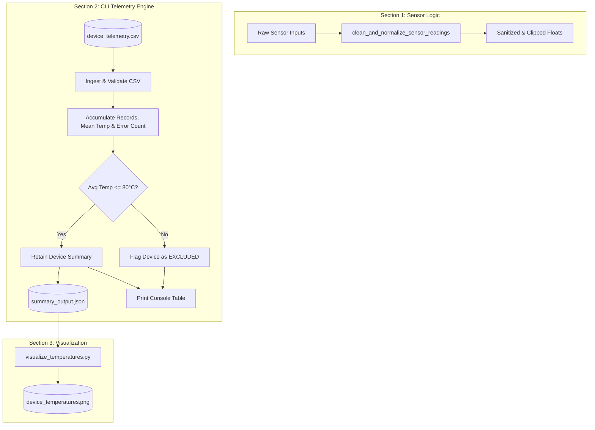

# 📊 Device Log Summarizer & Telemetry Analytics CLI

[](https://www.python.org/)
[](./tests/)
[](https://peps.python.org/pep-0008/)
[](./LICENSE)

A production-grade Python CLI tool and telemetry analysis pipeline built for the **Software Engineering Intern Technical Assessment**.

---

## 📑 Table of Contents
- [Architecture & Data Pipeline](#-architecture--data-pipeline)
- [Repository Structure](#-repository-structure)
- [Quick Start](#-quick-start)
- [Section 1: Data Sanitization & Logic](#-section-1-data-sanitization--logic)
- [Section 2: Core Data Processing CLI Tool](#-section-2-core-data-processing-cli-tool)
- [Section 3: AI Prompting & Visualization](#-section-3-ai-prompting--visualization)
- [Automated Testing Suite](#-automated-testing-suite)
- [Robustness & Edge-Case Handling](#-robustness--edge-case-handling)

---

## 🏗 Architecture & Data Pipeline



---

## 📂 Repository Structure

```text
.
├── section1_sanitization.py    # Section 1: Pure Python sensor data cleaning & clipping
├── device_log_summarizer.py    # Section 2: Robust CLI summarizer, table reporter & JSON exporter
├── visualize_temperatures.py   # Section 3: Matplotlib visualization module (Agg backend)
├── device_telemetry.csv        # Realistic sample input telemetry data
├── summary_output.json         # Section 2 Sample exported JSON summary
├── device_temperatures.png     # Section 3 Generated publication-grade 300 DPI chart
├── PROMPT_LOG.md               # Section 3 Deliverable: Detailed AI interaction log
├── submission.zip              # Pre-packaged archive ready for instant submission
├── README.md                   # Complete documentation
└── tests/
    ├── __init__.py
    ├── test_sanitization.py    # Unit tests for Section 1 (9 tests)
    ├── test_summarizer.py      # Unit tests for Section 2 CLI & Data Processing (8 tests)
    └── test_visualizer.py      # Unit tests for Section 3 Visualization (5 tests)
```

---

## 🚀 Quick Start

### Installation
Clone this repository and ensure Python 3.9+ is installed:
```bash
git clone <your-repository-url>
cd <repository-directory>
pip install -r requirements.txt  # or: pip install matplotlib pandas pytest
```

---

## 🧹 Section 1: Data Sanitization & Logic

**File:** [`section1_sanitization.py`](./section1_sanitization.py)

Cleans and normalizes sensor readings with zero external dependencies:
1. **Type Conversion & Filtering**: Converts values to float where possible; discards non-convertible items, `None`, booleans (`True`/`False`), and negative readings ($< 0$).
2. **Clipping**: Any valid value exceeding `500.0` is capped at `500.0`.
3. **Resilience**: Safely handles empty lists, `None`, non-iterables, or entirely corrupt entries without unhandled exceptions.

```bash
python section1_sanitization.py
```

#### Verification Run:
```text
Running Section 1: Sensor Readings Sanitization Tests...

Test 1 (Mixed Input):
  Input:    [12.5, '45.2', None, -1.0, 'ERR_FLAG', 600.0, 0.0, '100', 500.0]
  Output:   [12.5, 45.2, 500.0, 0.0, 100.0, 500.0] -> PASSED

Test 2 (Entirely Invalid Input):
  Input:    [None, 'SENSOR_TIMEOUT', -999.0, '-42.5', None, 'N/A']
  Output:   [] -> PASSED

Test 3 (Empty List):
  Input:    []
  Output:   [] -> PASSED

All Section 1 test cases passed successfully!
```

---

## ⚙️ Section 2: Core Data Processing CLI Tool

**File:** [`device_log_summarizer.py`](./device_log_summarizer.py)

A modular command-line tool that ingests telemetry data, aggregates statistics per device, applies an average temperature filter ($> 80.0^\circ\text{C}$ excluded), and outputs both formatted terminal tables and a clean JSON report.

```bash
# Basic run with default parameters:
python device_log_summarizer.py

# Custom input/output paths and custom threshold:
python device_log_summarizer.py device_telemetry.csv -o summary_output.json -m 80.0 --verbose
```

#### Terminal Report Output:
```text
========================================================================
                    DEVICE TELEMETRY SUMMARY REPORT                     
========================================================================
| Device ID    | Total Records |  Avg Temp (C) | Error Count | Filter Status   |
|--------------|---------------|---------------|-------------|-----------------|
| DEV_A        |             6 |         68.50 |           1 | PASS (<= 80.0)  |
| DEV_B        |             5 |         74.38 |           0 | PASS (<= 80.0)  |
| DEV_C        |             6 |         44.40 |           2 | PASS (<= 80.0)  |
| DEV_E        |             6 |         58.00 |           0 | PASS (<= 80.0)  |
| DEV_D        |             - |         86.64 |           - | EXCLUDED (> 80.0) |
------------------------------------------------------------------------
 Telemetry Rows Processed : 28
 Devices Retained (<= 80.0 C) : 4
 Devices Excluded (> 80.0 C)  : 1
========================================================================
[INFO] Successfully saved summary JSON to: .../summary_output.json
```

#### Sample JSON Output ([`summary_output.json`](./summary_output.json)):
```json
[
    {
        "device_id": "DEV_A",
        "total_records": 6,
        "average_temperature": 68.5,
        "error_count": 1
    },
    {
        "device_id": "DEV_B",
        "total_records": 5,
        "average_temperature": 74.38,
        "error_count": 0
    },
    {
        "device_id": "DEV_C",
        "total_records": 6,
        "average_temperature": 44.4,
        "error_count": 2
    },
    {
        "device_id": "DEV_E",
        "total_records": 6,
        "average_temperature": 58.0,
        "error_count": 0
    }
]
```

---

## 📈 Section 3: AI Prompting & Visualization

**Script:** [`visualize_temperatures.py`](./visualize_temperatures.py)  
**Deliverable Log:** [`PROMPT_LOG.md`](./PROMPT_LOG.md)

This section demonstrates collaborative AI engineering: guiding an LLM to generate an initial plotting script, critically identifying layout, formatting, and headless environment bugs, and iteratively refining it into a publication-ready module.

```bash
python visualize_temperatures.py
```

### Generated Visual Output


### Key Refinements Applied:
- **Headless Backend**: Added `matplotlib.use("Agg")` to eliminate GUI/Tkinter dependencies and prevent crashes in automated CI/CD pipelines.
- **Label Collision Prevention**: Added `rotation=15` and `plt.tight_layout()` to guarantee labels never overlap or clip outside margins.
- **Data Callouts**: Annotated exact temperatures and error indicators directly above each bar.
- **Contextual Threshold**: Visualized the 80.0°C upper boundary with a red dashed reference line.

---

## 🧪 Automated Testing Suite

Comprehensive unit tests are implemented in [`tests/`](./tests/) using `pytest`.

```bash
pytest -v
```

```text
============================= test session starts =============================
platform win32 -- Python 3.13.5, pytest-9.1.1, pluggy-1.6.0
rootdir: D:\Desktop\testright Nanosystem
collected 22 items

tests/test_sanitization.py::TestSensorReadingsSanitization::test_mixed_valid_and_invalid_inputs PASSED [  4%]
tests/test_sanitization.py::TestSensorReadingsSanitization::test_empty_list PASSED [  9%]
tests/test_sanitization.py::TestSensorReadingsSanitization::test_entirely_invalid_inputs PASSED [ 13%]
tests/test_sanitization.py::TestSensorReadingsSanitization::test_non_list_inputs PASSED [ 18%]
tests/test_sanitization.py::TestSensorReadingsSanitization::test_clipping_behavior PASSED [ 22%]
tests/test_sanitization.py::TestSensorReadingsSanitization::test_negative_filtering PASSED [ 27%]
tests/test_sanitization.py::TestSensorReadingsSanitization::test_zero_is_preserved PASSED [ 31%]
tests/test_sanitization.py::TestSensorReadingsSanitization::test_boolean_filtering PASSED [ 36%]
tests/test_sanitization.py::TestSensorReadingsSanitization::test_whitespace_strings PASSED [ 40%]
tests/test_summarizer.py::TestDeviceLogSummarizer::test_accumulator_calculations PASSED [ 45%]
tests/test_summarizer.py::TestDeviceLogSummarizer::test_accumulator_empty PASSED [ 50%]
tests/test_summarizer.py::TestDeviceLogSummarizer::test_processing_and_filtering PASSED [ 54%]
tests/test_summarizer.py::TestDeviceLogSummarizer::test_corrupted_rows_handling PASSED [ 59%]
tests/test_summarizer.py::TestDeviceLogSummarizer::test_missing_file_error PASSED [ 63%]
tests/test_summarizer.py::TestDeviceLogSummarizer::test_empty_file_error PASSED [ 68%]
tests/test_summarizer.py::TestDeviceLogSummarizer::test_missing_headers_error PASSED [ 72%]
tests/test_summarizer.py::TestDeviceLogSummarizer::test_json_export PASSED [ 77%]
tests/test_visualizer.py::TestVisualizer::test_load_telemetry_summary_valid PASSED [ 81%]
tests/test_visualizer.py::TestVisualizer::test_load_telemetry_summary_missing_file PASSED [ 86%]
tests/test_visualizer.py::TestVisualizer::test_load_telemetry_summary_invalid_json PASSED [ 90%]
tests/test_visualizer.py::TestVisualizer::test_generate_chart_creates_image PASSED [ 95%]
tests/test_visualizer.py::TestVisualizer::test_generate_chart_empty_dataset PASSED [100%]

============================= 22 passed in 1.97s ==============================
```

---

## 🛡 Robustness & Edge-Case Handling

| Potential Failure Scenario | Handled By | Outcome |
|---|---|---|
| **Missing CSV file** | `device_log_summarizer.py` | Logs clean error, exits with status 1; no uncaught traceback. |
| **Corrupted / Incomplete CSV rows** | `device_log_summarizer.py` | Bad rows skipped with diagnostic warnings; valid records preserved. |
| **Empty input / No matching devices** | `device_log_summarizer.py` & `visualize_temperatures.py` | Produces empty JSON `[]` and placeholder chart; no division-by-zero crashes. |
| **Headless / Container execution** | `visualize_temperatures.py` | Uses non-interactive `Agg` backend; zero Tkinter/X11 GUI dependency. |
| **Non-numeric / NaN sensor inputs** | `section1_sanitization.py` | Safely converts or drops without raising unhandled `ValueError` or `TypeError`. |
